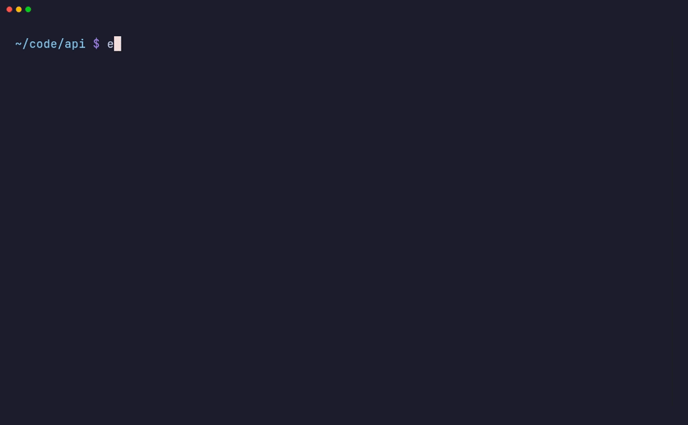

# else.sh

**Type a prompt in your shell. Your coding agent picks it up.**

You forget you're not inside Claude Code and type `fix the flaky token test` into a plain terminal.
Instead of `command not found`, else.sh starts your agent with exactly that prompt.



```
if   the command exists      → it runs, as always
elif it looks like a typo    → the normal "command not found"
else                         → your agent starts with what you typed
```

Website: **https://cristi-boboc.github.io/else.sh/**

## Install

macOS, Linux, WSL:

```sh
curl -fsSL https://cristi-boboc.github.io/else.sh/install.sh | sh
```

Windows (PowerShell):

```powershell
irm https://cristi-boboc.github.io/else.sh/install.ps1 | iex
```

The installer detects your OS and CPU, downloads the matching binary from the
[latest release](https://github.com/cristi-boboc/else.sh/releases/latest), checks its SHA-256,
then runs `else.sh install`. That command:

1. detects the shell you ran it from and adds a hook to its startup file,
2. finds the agents on your `PATH` and picks a default,
3. writes `~/.config/else.sh/config.toml` (`%APPDATA%\else.sh\config.toml` on Windows).

Open a new terminal and type something you'd say to an agent.

Homebrew (macOS): `brew install --cask cristi-boboc/tap/else.sh && else.sh install`
Scoop (Windows): `scoop bucket add cristi-boboc https://github.com/cristi-boboc/scoop-bucket && scoop install else.sh && else.sh install`

With Go 1.26+: `go install github.com/cristi-boboc/else.sh/cmd/else.sh@latest && else.sh install`.

## Agents

The first one found on your `PATH` becomes the default. Change it with `else.sh use <agent>`.

| agent      | started as                              |
|------------|-----------------------------------------|
| `claude`   | `claude "<prompt>"`                     |
| `codex`    | `codex "<prompt>"`                      |
| `gemini`   | `gemini -i "<prompt>"`                  |
| `copilot`  | `copilot -i "<prompt>"`                 |
| `cursor`   | `cursor-agent "<prompt>"`               |
| `opencode` | `opencode --prompt "<prompt>"`          |
| `qwen`     | `qwen -i "<prompt>"`                    |
| `goose`    | `goose run --interactive -t "<prompt>"` |
| `aider`    | `aider --message "<prompt>"`            |

Add your own, or change how a built-in one starts, in the config:

```toml
default_agent = "claude"

[agents.claude]
args = ["--model", "opus", "{prompt}"]

[agents.mine]
command = "my-agent"
args = ["chat", "{prompt}"]
```

## Shells

| shell                                | hook                                     | startup file |
|--------------------------------------|------------------------------------------|--------------|
| bash ≥ 4                             | `command_not_found_handle`               | `~/.bashrc` (`~/.bash_profile` on macOS) |
| zsh                                  | `command_not_found_handler`              | `~/.zshrc` |
| fish                                 | `fish_command_not_found`                 | `~/.config/fish/conf.d/else.sh.fish` |
| PowerShell 7 / Windows PowerShell 5.1 | `CommandNotFoundAction`                 | `$PROFILE.CurrentUserAllHosts` |

An existing handler (such as Ubuntu's `command-not-found` suggestions) is kept and still runs when
else.sh passes on a line. `cmd.exe` has no command-not-found hook, so it isn't supported.
macOS ships bash 3.2, which has no hook either; use zsh (the default) or `brew install bash`.

## How it decides

else.sh sees lines your shell could not run. On top of that, a line that starts with *what*, *why*, *how* or
*explain* and has three or more words, or any question (*where*, *which*, *is*, *can*…) ending in `?`, is handed
to the agent when you press Enter, even if its first word happens to be a real command. Everything else
runs exactly as before.

| you type                         | result |
|----------------------------------|--------|
| `refactor the auth middleware`   | agent  |
| `why is CI red`                  | agent (starts with a question or verb such as *why*, *fix*, *explain*) |
| `tests?`                         | agent (ends with `?`) |
| `what does it do ?`              | agent, even though macOS has a `/usr/bin/what` command |
| `gti status`                     | normal error, one edit away from `git` |
| `foo`                            | normal error, a single word |
| any line in a script or pipe     | normal error, only interactive terminals are handled |

Things to know:

- A line that starts with a real command runs that command: `make the tests pass` runs `make`.
  Use `else.sh ask make the tests pass` for those.
- Apostrophes are fine in those question lines (`what's in this repo`). Elsewhere an apostrophe still opens a
  quote, so the shell waits for more input.
- In zsh, else.sh sets `no_nomatch` so a `?` in a prompt doesn't abort the line. Set `zsh_no_nomatch = false` to opt out.

## Commands

```
else.sh install [shell]     hook into your shell and pick a default agent
else.sh uninstall [shell]   remove the hook
else.sh agents              list known agents and which are installed
else.sh use <agent>         set the default agent
else.sh ask <prompt...>     send a prompt to the default agent explicitly
else.sh on | off            enable or disable the hand-off
else.sh doctor              show what else.sh detected
else.sh init <shell>        print the hook script (used by your startup file)
```

Set `ELSE_SH_DISABLE=1` to switch it off in one terminal, or `ELSE_SH_DEBUG=1` to see why a line was or wasn't handed over.

## Configuration

```toml
enabled = true        # else.sh on / off
default_agent = "claude"
min_words = 2         # shorter lines are treated as typos (unless they end with "?")
typo_guard = true     # skip lines whose first word is one edit away from a real command
zsh_no_nomatch = true
announce = true       # print "else.sh → claude" before the agent starts
```

## Releasing

Push a tag; GitHub Actions runs GoReleaser and publishes binaries for Linux, macOS, Windows and FreeBSD (amd64 and arm64):

```sh
git tag v0.2.0 && git push origin v0.2.0
```

The demo GIF is recorded with [VHS](https://github.com/charmbracelet/vhs) from `demo/demo.tape` (`make demo`).

## License

MIT
